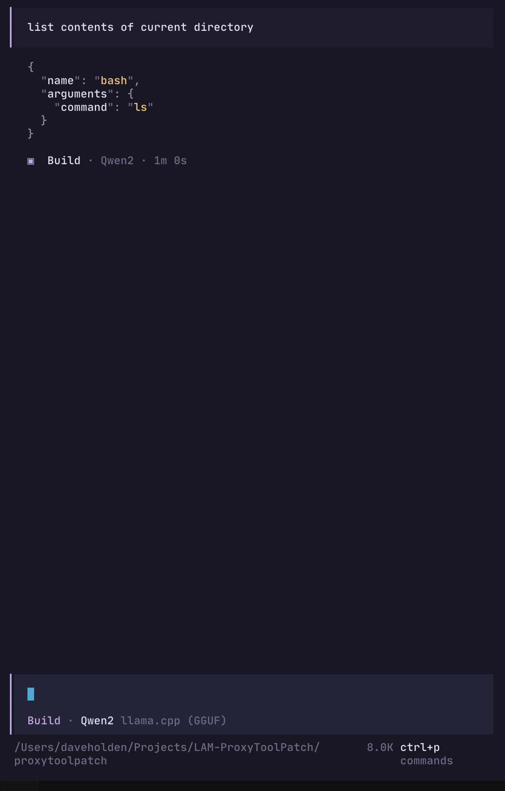
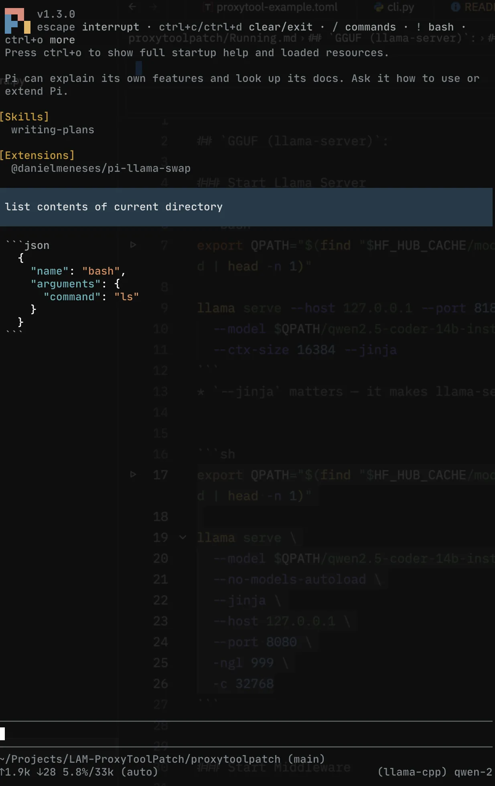
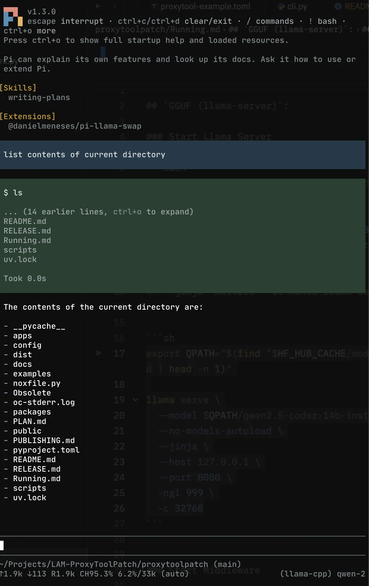

<!-- Project header -->

  <h1 style="display: inline; position: top; text-decoration: none;">proxytoolpatch</h1>
  
  
Fixing tool-call mismatches in local Qwen LLMs.

I wanted to run a coding LLM locally on my MacBook Pro M1 with 32GB RAM. Getting Qwen running wasn't the problem; getting it to work properly with coding agents like Pi and OpenCode was another matter.

When I asked an agent to list the contents of the current directory, the model sometimes returned a JSON object describing an `ls` command instead of producing a tool call the agent could execute. The request was clear enough; the hand-off between the model and the agent was the problem.

That's what led me to build **proxytoolpatch**: a small compatibility layer that sits between an OpenAI-compatible coding agent and a locally served model, and tries to turn common malformed tool-call output into something the client can use.

> The goal isn't to make a model smarter. It's to make the tool-call hand-off less fragile.

## The problem

These screenshots show the sort of mismatch that started the project.

| Coding agent | Without proxytoolpatch | With proxytoolpatch |
|---|---|---|
| **OpenCode** |  |  |
| **Pi** |  |  |

*Screenshots are illustrative examples from the original local setup; results depend on the model, server, client and configuration.*

## What's in the repository?

| Path | What it's for |
|---|---|
| [`apps/proxytool/`](apps/proxytool/README.md) | The FastAPI proxy application: the service you configure and run between your agent and model server. |
| [`packages/toolpatch/`](packages/toolpatch/README.md) | The reusable repair logic for recognising and normalising tool-call output. |

The proxy and repair package are separate on purpose: the app handles the HTTP/API side, while the package contains the tool-call patching logic.

## Quick start

1. **Run a local model server.** For example, `llama.cpp` can serve a GGUF model through an OpenAI-compatible API. Keep note of its base URL and model name.
2. **Install this project** using the instructions in [`apps/proxytool/README.md`](apps/proxytool/README.md).
3. **Point the proxy at your model server** using the configuration options documented by the app.
4. **Point your coding agent at the proxy**, rather than directly at the model server. Keep the same model and agent settings initially so you can compare behaviour.
5. **Try a simple tool-based task**, such as asking the agent to list the current directory. Check the logs if the call still doesn't work as expected.

Use the app README and the project's configuration examples for the current launch command and setting names.

## What it aims to help with

Depending on the model output and client/server combination, the project is intended to help with common compatibility problems such as:

- Tool calls emitted as text rather than structured tool-call data.
- Common textual formats for tool calls that an OpenAI-compatible client cannot execute directly.
- Differences between local inference servers and coding-agent expectations.
- Tool-call history that needs normalising before it can be sent back to a model.

This is a compatibility layer, not an inference engine or a coding agent. It does not guarantee that every model will call every tool correctly, and it can't make up for a model that doesn't know how to solve the task.

## Who is it for?

Developers running local models with coding agents such as Pi or OpenCode, particularly when the model can produce useful answers but its tool calls don't arrive in the format the client expects.

It may also be useful with other clients and servers that speak a compatible API, but compatibility depends on their behaviour and configuration.

## Documentation

- [Proxy application: setup, configuration and troubleshooting](apps/proxytool/README.md)
- [Tool-patching package: repair logic and development notes](packages/toolpatch/README.md)

## Contributing

Bug reports and reproducible examples are useful, especially when they include the model and quantisation, inference server and version, coding agent and version, and a redacted example of the original output versus the expected behaviour.

Remove API keys, private prompts, local paths and other sensitive details before sharing logs.

## License

See [`LICENSE`](LICENSE) for the project's license.
